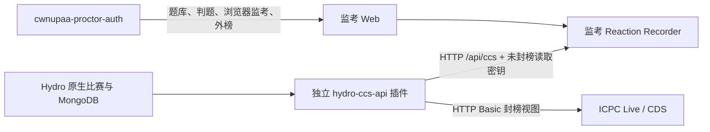

# 独立 Hydro CCS 与监考系统接入

从 `cwnupaa-proctor-auth 0.4.0` 起，CCS 服务只在独立的 **[pppolf/hydro-ccs-api](https://github.com/pppolf/hydro-ccs-api)** 仓库维护。本仓库保留 HTTP 消费适配器，不再包含 CCS 路由、计分、Hydro 数据映射或 Mongo 事件日志实现，也不通过 workspace、submodule 或相对路径引用独立仓库源码。



独立插件仍安装在 Hydro 宿主内，不需要另起 HTTP 服务。只需要 CCS 的用户无需安装监考平台；监考的 `HYDRO/local` 考试读取本地已同步结果，也无需 CCS。

## 两个仓库分别维护什么

| 仓库 | 负责内容 | 日常更新 |
| --- | --- | --- |
| `hydro-ccs-api` | CCS API、鉴权、允许清单、封榜、计分、事件日志、服务端测试与 API 文档 | 更新 Hydro 实际加载的独立插件目录并重启 Hydro |
| `proctoring-system` | 监考、评测桥接、录像采集/生成、CCS HTTP 消费与消费端测试 | 修改监考功能时更新 |

独立插件的 `README.md`、`docs/API.md`、`docs/DEPLOYMENT.md` 是安装、接口和服务端行为的维护入口。本页规定监考接入与迁移。当前消费契约针对 **hydro-ccs-api 1.x**；兼容的功能新增和修复无需更新监考仓库。未来若删除必需字段、改变鉴权或事件含义，应发布不兼容版本，并升级消费适配器。

## 首次接入

1. 将独立仓库部署到 Hydro 可读的固定目录，例如 `/opt/hydro-ccs-api`。使用 Hydro 实际运行用户执行 `hydrooj addon add /opt/hydro-ccs-api`，随后按现有服务管理方式重启 Hydro。只注册一次；部署源码不需要额外安装一套 Hydro。
2. 在 **Hydro → 系统设置 → CCS 比赛数据接口** 配置 `hydroCcsApi.contests`，如 `acm/691000000000000000000001`；主站域用 `system/比赛ID`。Basic 与未封榜读取密钥都受此清单限制。
3. 生成独立随机密钥（推荐 32 字节的十六进制字符串），填入 **CCS 未封榜读取密钥** `hydroCcsApi.adminApiKey`。不要复用评测密钥。直播/大屏的 EventFeed 使用这把密钥，在对应 HydroOJ 浏览器考试的设置中填写，只填密钥。直播另配置 `hydroCcsApi.username/password`，默认用户名 `ccs`。
4. 在监考 **Web 与 Recorder 两个实际运行进程**中配置相同的服务端环境变量：

```dotenv
REACTION_HYDRO_CCS_ORIGIN=https://hydro.example
REACTION_HYDRO_CCS_API_KEY="填写独立插件的未封榜读取密钥"
```

`ORIGIN` 只含协议、主机和端口，不带末尾 `/` 或域路径，须与考试平台地址的 origin 完全一致。考试地址可为 `https://hydro.example/d/acm`；消费者保留域路径，读取 `/d/acm/api/ccs/contests/<比赛ID>/event-feed`。密钥为 32–1024 个可见 ASCII 字符，不能有空白。外网使用 HTTPS，代理保留 `x-ccs-api-key` 并关闭事件流缓冲。

可选逐考试覆盖使用监考内部 `Exam.id`，每项必须完整；错误覆盖不会回退默认密钥：

```dotenv
REACTION_HYDRO_CCS_CREDENTIALS={"EXAM_ID":{"origin":"https://hydro.example","apiKey":"填写该站点的独立密钥"}}
```

这组配置与 NovaJudge 的 `REACTION_CCS_*`、监考评测 API-Key、直播 Basic 密码各自独立。缺失时明确报 `REACTION_HYDRO_CCS_CONFIGURATION`，不尝试旧接口或借用评测密钥。密钥只在服务端读取，不放进 `NEXT_PUBLIC_*` 或前端。

Recorder 启动命令显式读取 `apps/web/.env`；Next.js 的 `.env.local` 不会自动被该独立进程读取。基础 Compose 已将根 `.env` 中三项 `REACTION_HYDRO_CCS_*` 通过 `environment` 传入 Web；已有 Recorder 服务仍须显式传入相同配置。更改后重新创建相应容器，单纯重启不会刷新注入值。本仓库基础 Compose 没有 Recorder 服务，仍须按 [Recorder 部署](../README.md#5-docker-部署需要补齐的内容) 准备运行环境。通过 `env_file` 覆盖时注意同名 `environment`（包括空值）优先级更高。

提前开启 Reaction 并确认已连接。原生比赛仅支持固定起止时间的 `acm`，考号须匹配实际提交者用户名。详细录像行为见 [Hydro Reaction](reaction-hydro.md)，直播及视频映射见 [直播部署](hydro-live-deployment.md)。

## 从内置 CCS 迁移

建议赛前或维护窗口切换。先备份 Hydro MongoDB、监考数据库、插件目录与私有配置。

1. 先与旧插件并行安装独立 `hydro-ccs-api`，填好新设置并验证 `/api/ccs` 的 `provider.name` 为 `hydro-ccs-api`。域内前缀为 `/d/域ID/api/ccs`。旧插件 0.3.x 的 `/api/proctor/ccs` 与新路径不同，可用于切换前验证。
2. 配置 Web/Recorder 的新环境变量。更新两者代码，并将监考 Hydro 插件整体升级至 **0.4.1**。该版本不再注册旧 CCS 路由或设置；遗留 `ccs-*.ts` 文件不再加载，部署目录可在备份后清理。
3. 按原方式重启 Hydro、Web、Recorder。保持既有 Reaction 录制起点、记录和媒体存储；不要通过关闭再开启 Reaction 来迁移，因为关闭会取消待录制任务。
4. Live/CDS 地址改为 `/api/ccs`，填写独立插件的 Basic 账号。备份其缓存，按客户端方式清除旧源游标/建立新缓存；不要让旧 URL 经代理重定向来传递凭据。
5. 用测试比赛提交 WA/AC，验证新录像、账号映射、封榜、断线重连、重判和已有录像下载，再切换正式比赛。

| 项目 | 旧内置接口 | 独立接口 |
| --- | --- | --- |
| API | `/api/proctor/ccs` | `/api/ccs` |
| 未封榜鉴权 | `x-proctor-api-key` | `x-ccs-api-key` |
| 设置 | `cwnupaaProctor.ccs*` | `hydroCcsApi.*` |
| Mongo 日志 | `cwnupaa.proctor.ccs.*` | `hydro.ccs.api.*` |
| 扩展字段 | `x_proctor_username(s)`、`x_proctor_rank` | `x_hydro_username(s)`、`x_hydro_rank` |
| Recorder 游标 | `hydro-ccs-cursor / v1` | `hydro-ccs-cursor / standalone-v1` |

不会搬移、删除或重用旧日志。新插件首次访问从当前状态建立基线，无法补造切换前或停机期间未观察到的历史名次。Recorder 保留旧游标供审计，新游标另外记录；400 无效 token 会从无 token 流恢复。已有录制起点、提交唯一 ID 和事件检查点用于去重；原片判题、名次、窗口保持不变。已存在 Reaction 表的部署无需新增 MySQL 迁移。

回退时恢复匹配的旧插件、Web、Recorder 和私有配置；保留两套日志和原有录制记录。不要用清空数据库或媒体存储回退。

## 以后如何只更新 CCS

从独立 GitHub 仓库克隆后，在 **Hydro 实际加载的独立目录**更新，例如：

```sh
cd /opt/hydro-ccs-api
git status --short
git pull --ff-only
```

先检查版本说明并备份，再按已有方式重启 Hydro。也可部署独立仓库的固定版本源码包；不需要复制文件回监考仓库、重建监考 Web 或更新客户端。Recorder 会断线重连，兼容版本保留同一日志即可沿用 token。升级期间未观察到的中间重判无法恢复，仍建议避开比赛。

独立插件的 `hydro.ccs.api.commits` 与 `hydro.ccs.api.chunks` 两集合应一并备份恢复，不要只清除其中一个。

## 消费契约与验证

监考使用未封榜 GET NDJSON，要求每行有 `type/id/data/token`；空行为心跳，`data:null` 为删除。关心的类型为 `contest`、`teams`、`problems`、`submissions`、`judgements`，忽略其他资源。团队成员映射读取 `x_hydro_username(s)`，提交读取真实提交用户名。名次只接受与当前 token、比赛、提交者、提交、判题和 verdict 一致的 `x_hydro_rank`；缺失或不可靠名次不会变成数字名次。

### 名次与兼容边界

名次以独立插件的 `HYDRO_ACM_V1` 秒级规则及持久观察顺序为准，不代表数据库事务顺序。Live/CDS 可能按分钟自行重算；详细接口与罚时规则在独立仓库 `docs/API.md` 维护，监考侧证据校验见 [名次依据](reaction-ranking.md)。

在 `apps/web` 下运行 `node --import tsx --test tests/reaction-hydro.test.ts tests/reaction-ranking.test.ts`，仓库根运行监考插件的 `tests/*.test.cjs`（真实设置注册测试需指定 `HYDRO_PACKAGE_ROOT`）。消费测试只使用本仓库协议样本；CCS 服务端测试在独立仓库运行 `npm run check`。

自动化覆盖密钥隔离、域路径、旧游标切换、续传去重、账号映射、重判和浏览器保护共存。旧内置版本曾有实机联合测试；这不代表独立部署已验收，迁移后仍须在真实 Hydro/Mongo 与客户端环境检查。
