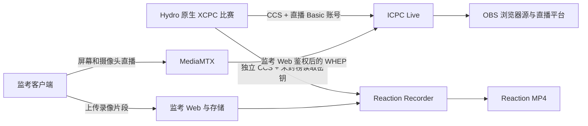

# Hydro XCPC 直播与 Reaction：使用和部署

## 监考后台内置赛事直播

升级监考后台及数据库后，从「XCPC 工具 → 赛事直播」选择考试。支持 HydroOJ 原生 XCPC 比赛、NovaJudge 浏览器比赛和本机 XCPC 比赛。赛事直播与大屏共用服务端 Event Feed：

- HydroOJ 读取 `[/d/域ID]/api/ccs/contests/<平台比赛ID>/event-feed`，使用 [独立 Hydro CCS](hydro-ccs.md) 的比赛允许清单和未封榜读取密钥。密钥在对应 HydroOJ 浏览器考试的设置中填写，站点和比赛 ID 沿用考试配置。
- NovaJudge 读取 `/api/ccs/contests/<平台比赛ID>/event-feed`，使用 [NovaJudge CCS 授权](reaction-ccs-auth.md) 的超级管理员账号。
- 本机 XCPC 使用监考系统已有的提交记录。

在「系统设置 → NovaJudge Event Feed 凭据」填写 NovaJudge 的站点根地址、超级管理员账号和密码。HydroOJ 浏览器考试的 EventFeed 密钥在对应考试的「HydroOJ 接入」中填写，只填密钥，站点地址和比赛 ID 沿用考试配置；系统设置不再显示 HydroOJ 的 EventFeed 表单。现有 `REACTION_HYDRO_CCS_*` 和 `REACTION_CCS_*` 环境变量以及旧系统 Hydro 凭据继续作为兼容回退。未配置相应站点的考试沿用已有数据源，已切到 Event Feed 的考试遇到读取错误时会提示并重试。赛事直播与大屏可独立使用，无需启动 Reaction Recorder。

直播和大屏用接口中的实际提交账号精确匹配监考考号，仅展示名单内账号的提交。没登录监考客户端的参赛者仍会出现在榜单和提交队列。有可用的监考直播流时可显示屏幕或电脑前置摄像头。也可以按账号上传队伍照片，用于没有视频或使用照片直播的场景。

在「直播设置 → 直播与大屏名称模板」可设置本场比赛的显示名，大屏管理页也有「设置名称模板」入口。默认模板为 `{org.name}: {team.name}`。`{org.name}` 与组织徽章都跟随「编辑考试 → 考试设置 → Reaction LOGO 匹配方式」，按学校或学院取值。`{school.name}` 固定取学校，`{college.name}` 固定取学院，`{team.name}` 取队名或姓名。模板引用的组织字段为空时，画面只显示队名或姓名。

在「直播设置 → 封榜」设置北京时间后才能开启预览、公开直播或生成 OBS 链接。封榜后提交显示为待揭晓。到达封榜时间后，导播可点击「揭晓直播榜单」一次性公开直播榜单的真实判题结果。大屏在自己的「封榜与揭晓」面板独立操作。

Event Feed 的完整判题结果只在服务端读取，直播与大屏按各自的封榜设置隐藏结果。对应页面的封榜设置不影响 HydroOJ 自己的公开榜单。清除封榜时间会停止赛事直播。

在「直播设置」生成专用 OBS 链接并添加为 1920×1080 浏览器源。「打开榜单大屏」使用同一份按名单筛选后的正式榜单。OBS 可使用私有链接读取导播选中的画面，公开链接的画面权限单独设置。
导播台的嵌入预览可拖动或按 16:9 缩放。榜单和计时器参数可在导播控制中展开。标题、广告和图片分别控制上下播。滚动条的长栏和短栏可以分别安排文字、时钟和图片，长栏还可以滚动显示指定名次的榜单。

「队伍画面」可为单队伍、双队伍或四分屏中的每个位置独立选择队伍、主媒体和辅助媒体。打开「批量调整」后，可以一次播出多处修改。无可用摄像头时，画面会保留可用媒体和队伍信息。

## 独立大屏控制

从「XCPC 工具 → 大屏管理」选中考试。先设置大屏封榜时间，再启用播放并生成播放地址。将地址粘贴到大屏设备的浏览器，按页面的「Fullscreen」按钮、F 键或浏览器的全屏快捷键进入全屏。多台设备可以打开同一地址，场景、转场和播放计划会跟随后台变更，无需手动刷新。
演示计划可以为每个场景设置单独的转场、停留时间和演示属性，也可保存后再次载入。黑屏操作保留当前计划和播放进度，重新显示后继续播放。

大屏使用本场考试的名单、题目、榜单和提交。队伍照片沿用赛事直播已上传的照片，校徽使用 Reaction 的学校 LOGO 库。播放页的固定文案为英文，封榜后待揭晓的结果显示为蓝色。播放地址可以重置或撤销，清除大屏封榜时间会停止播放并使旧链接失效。

大屏图表使用同一份赛事数据。HydroOJ 和 NovaJudge 的语言及判题完成时间来自 Event Feed。耗时从提交时间算到判题完成。来源未提供完成时间时，图表只使用已知数据。封榜期间图表不会统计被隐藏的判题时间和判题结果。

「历年赛事比较」和「一血」的「历史赛事来源」可选择最多四场自己管理、已发布并结束的赛事。历史结果可用时，会显示对应的历年曲线或首解队伍。标识、宣传图和图片序列可以在对应演示的属性中配置。

大屏控制需要数据库中的 `ContestDisplay` 表，使用本项目的 Prisma 部署流程升级，或应用 [大屏数据库迁移](../deployment/migrations/20261117-contest-display.sql)。

如使用独立的 ICPC Live 或 CDS 服务，请继续参照下文。

本指南使用独立 **hydro-ccs-api 1.x**、本仓库 **cwnupaa-proctor-auth 0.4.1**、Hydro 原生固定时间 `acm`（XCPC）比赛，以及支持 `WHEPVideo` 的 ICPC Live 3。旧内置 CCS 在 2026-11-09 验证过直连和经 CDS 2.7.1354 转发；独立插件迁移后仍须重新验收，其他 Live/CDS 版本应核对其 schema。两个仓库的维护边界及迁移步骤见 [独立 CCS 接入](hydro-ccs.md)。

本平台自行创建的 `HYDRO/local` 考试支持 Reaction，但当前不提供本指南的原生 CCS 或前后名次。该模式请按 [Hydro Reaction](reaction-hydro.md)启用；官网外榜开关另见[外榜推送](hydro-external-board.md)。下文域名、账号、ID 和路径都是配置示例，须替换为部署环境中的实际值。

## 1. 是否必须部署 CDS

**不必。只用 ICPC Live 展示比赛数据、接入监考画面时，推荐直接连接 Hydro CCS API。**

| 方案 | 数据链路 | 使用场景 |
| --- | --- | --- |
| 直接连接 | Hydro CCS → ICPC Live | 只需要 ICPC Live 导播、榜单和视频，配置最少 |
| 通过 CDS | Hydro CCS → ICPC Tools CDS → ICPC Live | 还要给其他 ICPC Tools 提供统一数据入口，或已有 CDS 工作流程 |

CCS 是比赛数据接口，提供队伍、题目、提交、判题、榜单和事件流；CDS 是可以转发这些数据的独立服务。ICPC Live 选择 `type: "clics"` 就可以读取兼容的 CCS。其帮助和代码中的“CDS options”也指自身数据源组件，不能据此判断必须运行外部 ICPC Tools CDS。

直播画面和 Reaction 分别走自己的链路：



ICPC Live 不负责替本项目启动 Recorder；关闭 CDS 不会停掉直接连接 Hydro 的 Recorder。只有比赛数据接口，也不会自动产生摄像头、屏幕或 Reaction 录像。

## 2. 先区分凭据和编号

| 凭据 | 在哪里配置 | 谁使用 |
| --- | --- | --- |
| Hydro CCS 直播用户名、密码 | **Hydro → 控制面板 → 系统设置 → CCS 比赛数据接口** | 直连的 ICPC Live，或连接 Hydro 的 CDS |
| Hydro CCS 未封榜读取密钥 | 同上，`hydroCcsApi.adminApiKey`；Web/Recorder 配置 `REACTION_HYDRO_CCS_API_KEY` | Hydro 原生 Reaction Recorder |
| 监考评测 API-Key | **监考后台 → 系统设置 → 评测服务设置**，与 Hydro“考试监考平台”的 API-Key 一致；其他 Hydro 站点在本场考试单独填写该站点插件 API-Key | 题库、评测、外榜；浏览器监考优先使用本场 Key |
| 监考直播 API Key | **监考后台 → 系统设置 → 直播 API Key 管理** | ICPC Live 的屏幕、摄像头 WHEP 播放地址 |

经过 CDS 时还有 CDS 自己的读取账号：ICPC Live 连接 CDS 用 CDS 账号；CDS 连接 Hydro 用 Hydro CCS 账号。它们不是 Hydro 选手账号，也不需要给直播账号 Hydro 管理员权限。

Hydro Reaction **不用** `REACTION_CCS_USERNAME` / `REACTION_CCS_PASSWORD`；这两个环境变量是本项目 NovaJudge 接入使用的，不要把 Hydro 的直播密码填进去。

| 编号 | 示例 | 用在哪里 |
| --- | --- | --- |
| Hydro 比赛 ID | `6af1ac04ca17daab5e44d1ec` | CCS `contestId`、Hydro 比赛 URL、监考考试的平台比赛 ID |
| Hydro 域 ID | `system`、`acm` | CCS 允许清单；非主站域的 URL 中使用 `/d/acm` |
| CCS 队伍 ID | `hydro02` | Hydro 队伍账号登录名，用作 ICPC Live 的 `overrideTeams` 键 |
| Hydro 用户名 / 监考考号 | `hydro02` | 监考名单、录像映射、WHEP 地址中的考号 |
| 监考考试编号 | `2026110901` | 客户端登录、WHEP 地址 |
| 监考内部 Exam.id | 从 `/dashboard/exams/{Exam.id}` 获取 | 后台详情 URL 中的标识；不是上述比赛 ID 或考试编号 |

## 3. 在 Hydro 安装或升级插件

监考插件与 CCS 插件各有自己的目录，分别注册；只使用直播数据时无需安装监考插件。已有内置 CCS 的部署先按 [迁移步骤](hydro-ccs.md#从内置-ccs-迁移) 切换。

1. 使用**运行 Hydro 服务的系统账号和同一 Hydro 配置环境**执行 `hydrooj addon list`，确认当前启用的插件路径。
2. 备份监考插件目录，部署本仓库 `hydro-plugin/cwnupaa-proctor-auth` 的完整 0.4.1 源码。另将独立仓库部署到 `/opt/hydro-ccs-api`；该目录的源码和文档以后只从独立仓库更新。
3. 首次安装时，在 Hydro 的实际运行环境中执行：

   ```bash
   hydrooj addon add /opt/proctoring-system/hydro-plugin/cwnupaa-proctor-auth
   hydrooj addon add /opt/hydro-ccs-api
   hydrooj addon list
   ```

   `/opt/proctoring-system` 改成实际路径。容器部署时必须是容器内可读取、持久保存的路径。升级已有插件不需要另加一份重复插件。

4. 按原服务管理方式重启 Hydro。例如本来由 PM2 管理、进程名确实为 `hydrooj` 时，执行 `pm2 restart hydrooj`；Docker 部署重启实际 Hydro 服务。
5. 用 Hydro 系统管理员打开 `/manage/setting`：监考配置在“考试监考平台”，独立 CCS 在“CCS 比赛数据接口”。只有域管理员权限可能无法进入系统设置；要求再次确认管理员密码时正常完成确认。

只更新监考 Web 不会更新 Hydro 插件；只更新仓库中的插件源码也不会自动替换另一台机器上已启用的插件。

## 4. CCS 鉴权具体填在哪里

打开 Hydro 的 `/manage/setting`，例如 `https://hydro.example/manage/setting`。本机测试若运行在 8888 端口，则使用 `http://127.0.0.1:8888/manage/setting`。

在“CCS 比赛数据接口”填写并保存：

| 页面字段 | 填写示例 | 说明 |
| --- | --- | --- |
| CCS 直播用户名 | `ccs` | 自定义 HTTP Basic 用户名；无需创建同名 Hydro 用户 |
| CCS 直播密码 | 自己生成的独立密码 | 配置后交给 ICPC Live 或 CDS；不要复用评测 API-Key |
| CCS 允许读取的比赛 | `system/6af1ac04ca17daab5e44d1ec` | 两种鉴权均受限；域内比赛如 `acm/691000000000000000000001` |
| CCS 未封榜读取密钥 | 独立随机密钥，32–1024 字符 | 给 Recorder 使用，也可填入对应 HydroOJ 浏览器考试的 EventFeed 密钥；推荐 32 字节随机值的十六进制字符串 |

多场比赛用逗号分隔，例如：

```text
system/6af1ac04ca17daab5e44d1ec,acm/691000000000000000000001
```

设置保存后即生效。密码框留空保留原值；首次未设置密码不能访问直播 CCS。清空比赛允许清单会同时停用所有直播与 Recorder 的比赛读取。只撤销某类凭据时，将对应密码或密钥替换为新随机值。

本接口只接受请求头认证；不要把 CCS 密码写成 URL 查询参数。外网使用 HTTPS，代理保留 `Authorization` 与独立 `x-ccs-api-key`。

检查连接：Windows PowerShell 使用 `curl.exe`，Linux 使用 `curl`。以下命令会提示输入密码，不把密码写进命令历史：

```powershell
curl.exe --fail --user ccs "http://127.0.0.1:8888/api/ccs/contests"
curl.exe --fail --user ccs "http://127.0.0.1:8888/api/ccs/contests/6af1ac04ca17daab5e44d1ec/scoreboard"
curl.exe --fail --user ccs "http://127.0.0.1:8888/api/ccs/contests/6af1ac04ca17daab5e44d1ec/event-feed?stream=false"
```

把用户名改为实际配置值。持续流测试去掉 `?stream=false` 并加 `--no-buffer`，按 Ctrl+C 结束；没有新提交时只有空行心跳是正常现象。

非主站域要保留路径，例如 `https://hydro.example/d/acm/api/ccs/contests/...`。允许清单里也必须使用对应 `acm/比赛ID`。

## 5. ICPC Live 直接连接 Hydro：推荐方案

### 5.1 文件放在哪里

**以启动参数 `--config-directory` 指向的目录为准**，修改另一份 `config` 不会影响正在运行的实例。Live 的 JAR 与配置由部署者单独安装，本仓库只提供配置模板。

正式使用时建议给每场比赛单独准备配置目录，例如 `D:\broadcast\hydro-xcpc\config`，包含：

```text
config/
  settings.json       比赛数据源
  advanced.json       队伍显示、计分选项、视频映射
  creds.json          使用本说明的内联账号配置时可为 {}
  visual-config.json  外观；可为 {} 或沿用现有外观配置
```

仓库提供可复制的[直连模板](../deployment/icpclive-hydro/settings.direct.example.json)和[队伍/视频模板](../deployment/icpclive-hydro/advanced.example.json)。模板没有真实密码；复制到自己的私有配置目录，替换全部示例值，再将文件名改为 `settings.json` / `advanced.json`。

### 5.2 settings.json

```json
{
  "type": "clics",
  "feeds": [
    {
      "source": {
        "url": "https://hydro.example/api/ccs",
        "login": "ccs",
        "password": "填写Hydro中的CCS直播密码"
      },
      "contestId": "691000000000000000000001",
      "feedVersion": "2023_06"
    }
  ]
}
```

- `source.url` 填 **API 基址**，不是比赛网页、`/scoreboard` 或完整 `/event-feed` URL。
- 主站域是 `https://hydro.example/api/ccs`；域内比赛是 `https://hydro.example/d/acm/api/ccs`。
- 同机测试可使用 `http://127.0.0.1:8888/api/ccs`，`contestId` 仍须填写实际比赛 ID。
- 字段名是 `login`，不是 `username`。直连 Hydro 使用 `2023_06`，下划线不能改为连字符。
- `creds.json` 不是把任意用户名密码写进去就会自动登录；本说明采用 schema 支持的 `source.login` / `source.password`，因此 `creds.json` 可为 `{}`。

### 5.3 计分与打星队

ICPC Live 会根据事件自行计算榜单。`advanced.json` 可使用：

```json
[
  {
    "type": "overrideScoreboardSettings",
    "penaltyRoundingMode": "sum_in_seconds"
  },
  {
    "type": "overrideGroups",
    "rules": {
      "participants": { "isHidden": false, "isOutOfContest": false },
      "observers": { "isHidden": false, "isOutOfContest": true }
    }
  }
]
```

默认的 `each_submission_down_to_minute` 会逐题向下取整分钟，与 Hydro 秒级计分不同。`sum_in_seconds` 可以保留秒级罚时，但**不保证与 Hydro 完全一致**：本次直连实测 Hydro 为 5191 秒，ICPC Live 为 5192 秒；另一队为 28893 / 28894 秒，当前名次一致。来源中的毫秒累计方式仍有区别，不能把这个开关当成严格的 Hydro 排名适配。

正式比赛需核对同解题数、临界同罚时、重判和打星场景。Hydro 原生名次以 CCS `/scoreboard` 的 `rank`、`x_hydro_total_seconds` 为准；本项目 Reaction 使用 Hydro 保存的名次上下文，不使用 ICPC Live 重算结果。

上述配置显示打星队，并通过 `observers.isOutOfContest` 将其排除在正式排名之外。Hydro CCS 的分组 ID 为 `participants` 和 `observers`。

### 5.4 启动与 OBS

安装该 Live 版本要求的 Java（测试版本为 Java 17），将 JAR 放到自己的部署目录。以下为 PowerShell 本机测试示例：

```powershell
& "$env:JAVA_HOME\bin\java.exe" -jar 'D:\broadcast\icpc-live.jar' --config-directory='D:\broadcast\hydro-xcpc\config' --creds='D:\broadcast\hydro-xcpc\config\creds.json' --visual-config='D:\broadcast\hydro-xcpc\config\visual-config.json' -p 9091 --no-auth
```

`9091` 为示例端口，可换成空闲端口；Java、JAR 和配置路径均以实际安装位置为准。

- 导播台：`http://127.0.0.1:9091/admin/controls`。
- OBS 添加“浏览器”来源：`http://127.0.0.1:9091/overlay?noStatus`，宽 1920、高 1080。
- 在导播台显示 Scoreboard；视频接好后，在 TeamView 选择队伍和 `screen` / `camera`，再显示。
- 配置变更后重启该 Live 实例以确认生效；旧实例占用端口时不要重复启动。
- `--no-auth` 会关闭导播管理端认证，仅用于受控本机测试。正式服务按该 JAR 的 `--users-file` 机制配置管理账号，或在隔离管理网/反向代理上保护导播接口；不能把示例命令原样作为公开管理服务。

测试使用的 Live 3 JAR 曾出现 Overlay 在比赛信息尚未到达时读取题目数组而白屏的问题，测试副本增加空值保护后通过。该外部 JAR 及补丁不随本仓库发布；部署时应使用已修复的 Live 版本，并验证 Overlay 刷新和恢复 TeamView。该问题与是否经过 CDS 无关。

## 6. 给 ICPC Live 接屏幕和摄像头

1. 在监考后台“系统设置 → 直播 API Key 管理”生成并启用一把密钥。
2. 考生使用更新后的监考客户端登录、审核、开考；后台能看到对应屏幕和摄像头。
3. 读取 Hydro CCS `/contests/比赛ID/teams`，确认队伍用户名 `id`。下面以用户名和监考考号均为 `hydro02` 为例。
4. 在 `advanced.json` 的数组中**追加** `overrideTeams`（或合并到原有同类规则），每队明确填写 WHEP 地址：

   ```json
   {
     "type": "overrideTeams",
     "rules": {
       "hydro02": {
         "displayName": "Hydro Test 2",
         "medias": {
           "screen": {
             "type": "WHEPVideo",
             "url": "http://127.0.0.1:4031/api/2026110901/hydro02/1?apikey=填写监考直播APIKey"
           },
           "camera": {
             "type": "WHEPVideo",
             "url": "http://127.0.0.1:4031/api/2026110901/hydro02/2?apikey=填写监考直播APIKey"
           }
         }
       }
     }
   }
   ```

监考考号与登录用户名一致时，直播地址可使用 `/{team.id}/1`。机位 `1` 为屏幕，`2` 为电脑摄像头，`3` 为第二机位。多人队可选其中一个成员的媒体作为队伍直播画面，Reaction 按实际提交者用户名映射。

WHEP 由 **Overlay 所在浏览器/OBS** 发起。因此导播和 OBS 在另一台电脑时，地址里的 `127.0.0.1` 必须改成它能访问的监考服务地址，媒体 ICE 地址与端口也必须可达。仅能打开 Web 页面，不代表 WebRTC 视频链路可达。HTTPS 页面上的媒体接口也使用 HTTPS。

这些地址携带媒体读取密钥，供受控导播和 OBS 使用。普通观众观看 OBS 推送的直播平台画面。当前直播 API Key 可读取该监考服务器所有考试的可用机位，按直播系统单独分配并在停用时撤销。

详细媒体部署与网络配置见[直播流说明](直播流使用说明.md)和[网关部署](../deployment/CADDY_GATEWAY.md)。

## 7. 需要 CDS 时怎么接

### 7.1 CDS 连接 Hydro

在 CDS 的实际配置目录中设置 `cdsConfig.xml`，模板见[这里](../deployment/icpclive-hydro/cdsConfig.example.xml)：

```xml
<cds>
  <contest id="691000000000000000000001"
           path="/srv/cds/contests/hydro-xcpc"
           recordReactions="false">
    <ccs url="https://hydro.example/api/ccs/contests/691000000000000000000001"
         user="ccs"
         password="填写Hydro的CCS直播密码" />
  </contest>
</cds>
```

与 ICPC Live 直连配置不同，CDS 的 `ccs.url` 填**完整比赛资源地址**，以 `/contests/比赛ID` 结束。本说明保持 CDS contest ID 与 Hydro ID 相同。`path` 必须是 CDS 可读写的独立缓存目录；Windows 可写 `D:/broadcast/cds/contests/hydro-xcpc`。XML 中密码含 `&`、`<`、引号时要按 XML 规则转义。

使用本项目 Recorder 时关闭 CDS 自身 Reaction 录制，即 `recordReactions="false"`。保留已有 CDS 管理账号，在 `accounts.yaml` 加一个给 Live 使用的读取账号，例如该测试版本支持的：

```yaml
- username: live-reader
  password: REPLACE_WITH_CDS_READER_PASSWORD
  type: analyst
```

不要用这一段覆盖已有账号文件。按既有 CDS 服务方式重启，并先确认它能取得 Hydro 比赛数据。

### 7.2 ICPC Live 连接 CDS

使用 [CDS 数据源模板](../deployment/icpclive-hydro/settings.cds.example.json)：

```json
{
  "type": "clics",
  "feeds": [
    {
      "source": {
        "url": "https://cds.example/api",
        "login": "live-reader",
        "password": "填写CDS读取账号密码"
      },
      "contestId": "691000000000000000000001",
      "feedVersion": "2026_01"
    }
  ]
}
```

`2026_01` 是**本次测试 CDS 2.7.1354 输出**对应的配置；它会输出时长字符串，继续用 `2023_06` 会解析失败。其他 CDS 版本以实际输出和 Live 支持版本为准。直连 Hydro 仍用 `2023_06`。

CDS 自签名证书须被运行 Live 的 Java 信任；本机测试为该 Java 进程单独配置了 trustStore。正式使用受信任证书，或导入部署机构的 CA；不要照搬本机证书、口令或关闭全局 TLS 校验。

经过 CDS 后，视频仍按第 6 节接监考 WHEP；不会因为 CDS 中已有队伍就自动找到对应考号。

## 8. 监考与 Reaction 部署

### 8.1 准备基础服务

Hydro 和 HydroJudge/go-judge 应已能独立完成真实判题。监考平台需要 MySQL、Web、考生网页、桌面客户端；直播画面还需要 MediaMTX。Reaction 在此基础上增加独立 Recorder、FFmpeg/FFprobe、Python 3.12+ 和官方生成器。

新建监考环境按 [README](../README.md) 配置 `.env`、数据库和媒体；只有空白新库才按新库流程初始化。已有旧部署先备份，按 [Reaction 迁移说明](reactions.md#部署与入口) 对比数据库，缺少 Reaction 表时执行 `deployment/migrations/20261104-reactions.sql` 并重新生成 Prisma Client。已经有这些表的本机环境不需再初始化或重复执行迁移。

更新代码后，在仓库根目录准备构建：

```powershell
pnpm install --frozen-lockfile
pnpm db:generate
pnpm build:web
pnpm build:client
pnpm build:desktop
```

按原服务管理方式启动生产 Web / 考生网页，对应命令为：

```powershell
pnpm --filter @cwnupaa/proctor-web start
pnpm --filter @cwnupaa/proctor-client-web start
```

它们是两个常驻进程，分别由服务管理器管理。发布桌面安装包使用 `pnpm dist:desktop:win`，安装到选手机器；构建时确认 `apps/desktop/src/renderer/config.js` 中服务器、考生网页、媒体地址适合目标网络。

本次桌面修复包括 Hydro 静态资源加载、题目新窗口转为当前页面，以及左箭头按比赛页面层级返回。正式发布要使用包含这些修改的安装包；无需修改 Hydro 静态文件或注入页脚脚本。

### 8.2 配置监考考试

1. Hydro 创建 `acm`（页面通常显示 XCPC）比赛，设固定开始、结束时间，添加题目并确认判题正常。不要设置每人独立计时的 `duration`。
2. 在 Hydro 创建/导入选手并加入比赛。监考用户名、密码与实际 Hydro 登录账号一致。
3. 同一站点比赛：监考后台“系统设置 → 评测服务设置”填写 Hydro 服务地址及 API-Key；Hydro 插件填写同一 Key。使用其他 HydroOJ 站点时保持原评测服务和题库同步映射不变，改为在下一步的本场考试中填写目标站点插件 API-Key。
4. 新建监考考试，选择 **HydroOJ（监考与浏览器）**，填平台地址、24 位比赛 ID，与 Hydro 保持相同赛程。域内比赛的平台地址填到 `/d/域ID`。其他站点须同时填写该站点监考插件 API-Key；赛制、比赛类型和判题由 HydroOJ 管理，本平台无需读取或填写。
5. 导入考生，**考号等于 Hydro `uname`**。设置考室审核方式和需要的屏幕、摄像头、第二机位。
6. 发布后，监考登录会单独限制对应的 HydroOJ 账号，该账号须在监考客户端中答题。同一场比赛中未通过监考登录的参赛账号，仍按 HydroOJ 原生权限使用普通浏览器。

不要把“本平台考试，Hydro 只负责判题”的 `HYDRO/local` 模式当成原生 Hydro 比赛；本指南的 CCS 直播与名次变化针对原生 XCPC。

### 8.3 安装生成器并启动 Recorder

先在 Web 和 Recorder 的实际服务端环境配置 `REACTION_HYDRO_CCS_ORIGIN=https://hydro.example` 与 `REACTION_HYDRO_CCS_API_KEY`（与独立插件的未封榜读取密钥一致）。origin 不带路径，域路径来自考试设置；比赛必须在独立 CCS 允许清单内。详见 [配置说明](hydro-ccs.md#首次接入)。

Windows 在仓库根目录运行：

```powershell
.\scripts\setup-reaction-generator.ps1
```

脚本要求已有 Git、Python 3.12+、FFmpeg、FFprobe，创建独立虚拟环境，安装固定版本官方生成器。将脚本输出的两个真实路径填入 `apps/web/.env`：

```dotenv
REACTION_GENERATOR_ROOT="D:/actual/path/reactions-generator"
REACTION_GENERATOR_PYTHON="D:/actual/path/venv/Scripts/python.exe"
FFMPEG_PATH="D:/actual/path/ffmpeg.exe"
FFPROBE_PATH="D:/actual/path/ffprobe.exe"
REACTION_GENERATOR_FONT="C:/Windows/Fonts/msyh.ttc"
REACTION_GENERATOR_FONT_BOLD="C:/Windows/Fonts/msyhbd.ttc"
```

路径改为真实存在的文件。生成器也需要在 Recorder 的 `PATH` 中找到 `ffmpeg` / `ffprobe`；缺 Python 包时应使用这里配置的虚拟环境 Python 安装，避免装到另一套 Python。Linux 的固定版本、venv 和字体步骤见[生成器部署](reaction-generator.md)。

在实际 `apps/web` 目录启动一个 Recorder：

```powershell
node --env-file=.env --import tsx scripts/reaction-recorder.ts
```

生产通过现有进程管理器、systemd 或独立容器守护，设置工作目录为实际 `apps/web`，失败自动重启。Recorder 与 Web 使用同一数据库、存储和加密相关配置；本地存储必须指向同一个实际上传目录。只运行 Web 不会执行独立 Recorder 任务。

该命令显式加载 `.env`，不会自动读取 Next.js 的 `.env.local` / `.env.production`。Docker 的基础 Compose 目前没有 Recorder 服务，也未自带完整 Python 生成器环境；需要增加包含上述运行时的 Recorder 镜像/服务，共用 Web 上传卷或 S3，并显式注入环境变量。更改容器环境后需重新创建容器，单纯 `restart` 不会更新注入值。完整容器注意事项见 [README 的 Recorder 部署](../README.md#5-docker-部署需要补齐的内容)。

### 8.4 开启本场 Reaction

在“考试详情 → Reaction 录像”开启并保存，等待事件来源显示“已连接”。建议首次保留默认缓存 60 秒、提交前 3 秒、判题后 10 秒；需要自动出片时另开“自动生成”，默认关闭。

选手开考并接好屏幕/摄像头后，等待至少一个缓存窗口，再自己提交。Recorder 记录判题结果，保留尾段，等待媒体上传，然后裁剪/合成。视频是否完整、生成是否成功是两种状态：`PARTIAL` 的可用素材有时也能生成，但不会变成完整录像。

开启前的历史提交不会补录；名次需要可靠事件基线，历史结果、打星队或依据不足时不补造数字名次。重判不会重写旧片里的原始结果和名次。内部 Reaction 可读取封榜后的真实结果，直播 Basic 视图仍隐藏封榜结果，因此封榜期发布 Reaction 成片应按赛事发布安排执行。

## 9. 代理、启动顺序与验收

事件流是持续 NDJSON，不是一次请求立即结束的 JSON。代理保留原路径和认证头、关闭响应缓存/缓冲，并允许长连接。Nginx 使用以下示意位置块时，替换真实 Hydro 上游，保留部署已有的 HTTPS 和请求头设置：

```nginx
location ~ ^/(?:d/[^/]+/)?api/ccs(?:/|$) {
    proxy_pass http://127.0.0.1:8888;
    proxy_http_version 1.1;
    proxy_set_header Host $host;
    proxy_set_header Authorization $http_authorization;
    proxy_set_header X-CCS-Api-Key $http_x_ccs_api_key;
    proxy_buffering off;
    proxy_cache off;
    proxy_read_timeout 3600s;
}
```

数据库、媒体内部控制端口不作为直播入口暴露。另一台机器、容器内的 `127.0.0.1` 都是其自身；按实际网络配置服务地址、DNS、HTTPS 和 WebRTC ICE。

启动顺序：

1. MongoDB、MySQL、存储、Hydro、判题服务。
2. 监考 Web、考生网页、MediaMTX，核对媒体鉴权回调可达。
3. Reaction Recorder，提前开启本场 Reaction 并确认已连接。
4. ICPC Live；只有采用 CDS 方案时先启动 CDS。
5. 选手监考客户端、OBS；等待媒体缓存，再提交测试。

正式开播前至少完成这些验证：

- 用直播账号读取比赛列表和榜单；允许清单之外的比赛不能读取。
- 在 Live 中核对题目、队伍、打星设置、解题数、罚时和名次；特别检查临界并列。
- 在 OBS Overlay 验证屏幕和摄像头实际播放。
- 使用真实选手账号提交一次 WA 和 AC，查看 Live 更新以及 Reaction 原片和成片。
- 测试封榜时直播隐藏结果、解封后结果恢复；Reaction 内部结果与发布安排一致。
- 短暂中断/重连数据源后确认继续更新，无重复 Reaction；已结束比赛仍可能接受重判，不将“比赛结束”等同于数据永不变化。

停机时先完成选手操作、保留尾段并等待上传/生成结束，再停止客户端、Live、Recorder 和基础服务。备份 Hydro MongoDB 时包含 `hydro.ccs.api.chunks` 与 `hydro.ccs.api.commits` 两个集合；同时备份监考 MySQL、上传存储和私有配置。不要只删除一个 CCS 集合来“重置榜单”。

## 10. 部署信息与数据源切换

每次部署保留一份私有运行说明，记录 Hydro 域名/域 ID/比赛 ID、监考考试编号、Web/Recorder 服务名、实际 Live JAR 版本及配置目录、导播与 Overlay 地址、媒体访问地址，以及凭据所在位置。不要把真实密码或带媒体密钥的 URL 提交到仓库。

从 CDS 切为直连时，备份 Live 的 `settings.json`，按第 5 节替换 `source.url`、Basic 账号及 `feedVersion`，核对 `contestId`，只重启 Live。保留 `advanced.json` 的队伍/媒体映射和已有外观配置。切回 CDS 时恢复备份，并确认 CDS 已启动、证书受信任。

本仓库的 `.local` 目录、私人测试脚本、测试账号、录像和外部软件二进制不属于部署包；新机器按本指南与仓库中的 `deployment/icpclive-hydro` 模板配置。

## 11. 常见问题

| 现象 | 检查与处理 |
| --- | --- |
| Hydro 找不到 CCS 设置项 | 是否系统管理员；是否启用独立 hydro-ccs-api；是否重启了实际 Hydro 服务 |
| CCS 返回 401 | Hydro 直播密码是否设置；Live/CDS 是否发 Basic；代理是否丢失 Authorization；不要混用 API-Key |
| CCS 返回 403 | `域ID/比赛ID` 是否在允许清单；域名/域路径是否一致 |
| CCS 返回 400 | 是否原生固定时间 acm；24 位比赛 ID 是否正确；自写消费者的 since_token 是否属于该比赛与视图 |
| CCS 返回 404 | 接口前缀应为 `/api/ccs`；插件是否更新；是否漏了 `/d/域ID` |
| Live 报 penalty_time 或时长解析错误 | 直连 Hydro 用 `2023_06`；本次 CDS 2.7.1354 用 `2026_01` |
| 改配置没效果 | 查看启动参数实际 `--config-directory`，确认修改的是该实例使用的文件并重启 |
| 榜单罚时/名次不同 | Live/CDS 自行计分；检查秒/分钟取整、打星配置与重判，用 Hydro `/scoreboard` 对照 |
| 榜单正常但视频不显示 | CCS 不含视频；检查 advanced 队伍映射、考号、机位、媒体 Key、考生在线状态与 ICE 网络 |
| Overlay 刷新后白屏 | 确认使用包含初始化空值保护的 Live JAR，并查看浏览器错误；不要只检查 CCS |
| 已通过监考登录的账号在普通浏览器不能答题 | 从监考客户端进入。同一场比赛中未通过监考登录的其他账号保留普通浏览器访问 |
| Reaction 显示已配置但未连接 | Recorder 是否常驻；Web/Recorder 是否同库并加载同一 CCS 环境；独立读取密钥、域和允许清单是否正确 |
| Reaction 一直等待或没有新录像 | 是否在启用后提交；考号是否等于实际 Hydro uname；Hydro 是否完成判题；客户端是否持续上传 |
| 生成任务 QUEUED / 生成器未配置 | 检查实际 Recorder 环境和进程；只启动 Web 不够；Python venv、FFmpeg、字体路径必须存在 |
| 视频缺少数字名次 | 历史快照、打星或依据不足不造名次；提前连接并开启 Reaction，用之后的新提交验收 |
| 本平台 Hydro 视频没有名次变化 | `HYDRO/local` 当前仅录制评测结果；原生 XCPC CCS 才提供前后名次 |
| 已有视频提示 Submission ID 无效 | 更新监考 Web 的导出校验，支持完整 `sub_<UUID>`；刷新后重试，无需重新生成成片 |

接口细节见 [Hydro CCS](hydro-ccs.md)，录像机制见 [Hydro Reaction](reaction-hydro.md)，生成器与媒体分别见 [reaction-generator.md](reaction-generator.md) 和[直播流说明](直播流使用说明.md)。
